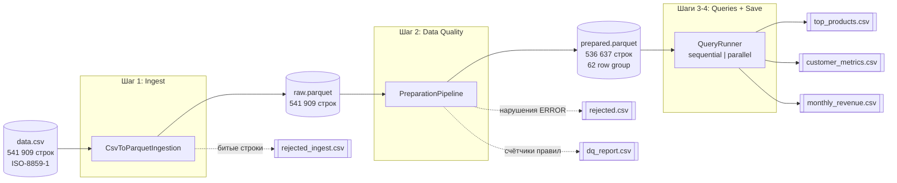
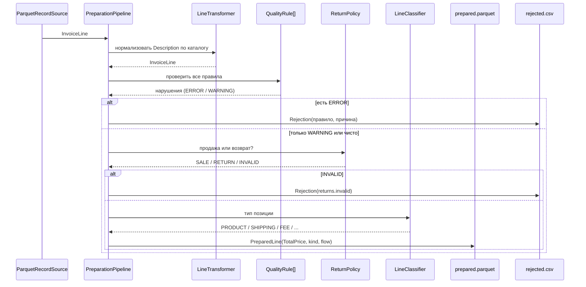
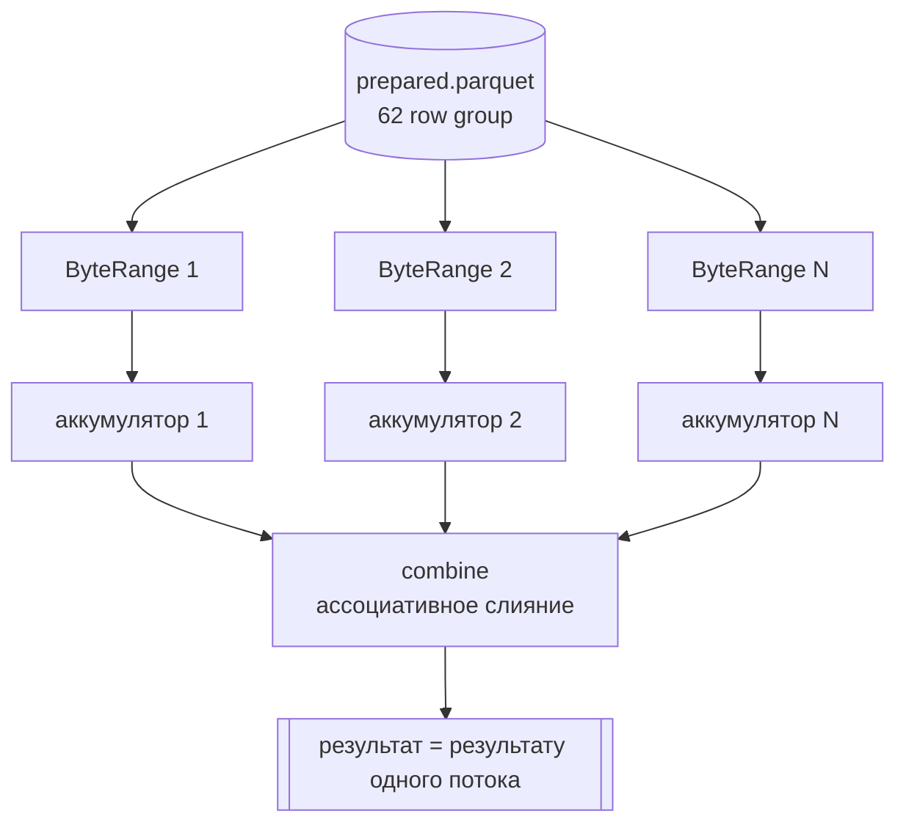

# Архитектура пайплайна

## Поток данных

Почему два слоя parquet, а не один: правила качества меняются чаще, чем формат
источника. Разбор CSV делается один раз, дальше DQ-прогон читает колоночный
`raw.parquet` и его можно перезапускать с новыми правилами, не трогая CSV.

## Классы и интерфейсы

```mermaid
classDiagram
    direction LR

    class RowSource {
        <<interface>>
        +header() List~String~
        +rows() Stream~RawRow~
    }
    class RecordSource~T~ {
        <<interface>>
        +records() Stream~T~
    }
    class RecordSink~T~ {
        <<interface>>
        +write(T record)
        +written() long
    }
    class RowParser~T~ {
        <<interface>>
        +parse(RawRow) ParseResult~T~
    }
    class ParquetMapper~T~ {
        <<interface>>
        +schema() Schema
        +toRecord(T) GenericRecord
        +fromRecord(GenericRecord) T
    }

    CsvRowSource ..|> RowSource
    ParquetRecordSource ..|> RecordSource
    CsvRecordSink ..|> RecordSink
    ParquetRecordSink ..|> RecordSink
    InvoiceLineParser ..|> RowParser
    RawLineMapper ..|> ParquetMapper
    PreparedLineMapper ..|> ParquetMapper
    ParquetRecordSink --> ParquetMapper
    ParquetRecordSource --> ParquetMapper

    class QualityRule {
        <<interface>>
        +name() String
        +severity() Severity
        +check(InvoiceLine) Optional~String~
    }
    class ReturnPolicy {
        <<interface>>
        +decide(InvoiceLine) ReturnDecision
    }
    class LineClassifier {
        <<interface>>
        +classify(InvoiceLine) LineKind
    }
    class LineTransformer {
        <<interface>>
        +apply(InvoiceLine) InvoiceLine
    }
    class ProductCatalog {
        <<interface>>
        +descriptionFor(code, fallback) String
        +size() int
    }
    class QualityReport {
        <<interface>>
        +onRead()
        +onAccepted()
        +onRejected(rule)
        +onViolation(rule, severity)
    }

    SimpleRule ..|> QualityRule
    DuplicateRowRule ..|> QualityRule
    DefaultReturnPolicy ..|> ReturnPolicy
    StockCodeClassifier ..|> LineClassifier
    CatalogDescriptionTransformer ..|> LineTransformer
    CatalogDescriptionTransformer --> ProductCatalog
    MostFrequentDescriptionCatalog ..|> ProductCatalog
    InMemoryQualityReport ..|> QualityReport

    class DataIngestion {
        <<interface>>
        +run() IngestResult
    }
    class DataPreparation {
        <<interface>>
        +run() PreparationResult
    }
    class Query~A~ {
        <<interface>>
        +name() String
        +newAccumulator() A
        +accumulate(A, PreparedLine)
        +combine(A, A) A
        +header() List~String~
        +rows(A) List
    }
    class QueryRunner {
        <<interface>>
        +run(Query~A~) A
        +mode() String
    }

    CsvToParquetIngestion ..|> DataIngestion
    PreparationPipeline ..|> DataPreparation
    SequentialQueryRunner ..|> QueryRunner
    ParallelQueryRunner ..|> QueryRunner
    TopProductsQuery ..|> Query
    CustomerMetricsQuery ..|> Query
    MonthlyRevenueQuery ..|> Query

    CsvToParquetIngestion --> RowSource
    CsvToParquetIngestion --> RowParser
    CsvToParquetIngestion --> RecordSink
    PreparationPipeline --> RecordSource
    PreparationPipeline --> LineTransformer
    PreparationPipeline --> QualityRule
    PreparationPipeline --> ReturnPolicy
    PreparationPipeline --> LineClassifier
    PreparationPipeline --> RecordSink
    PreparationPipeline --> QualityReport
    SequentialQueryRunner --> RecordSource
    ParallelQueryRunner --> RecordSource
    ParallelQueryRunner --> RowGroups

    Pipeline --> DataIngestion
    Pipeline --> DataPreparation
    Pipeline --> QueryRunner
```

## Обработка строки на шаге DQ

## Параллельное исполнение запросов

`Query` задан как map-reduce свёртка: `newAccumulator`, `accumulate`, `combine`.
Поэтому один и тот же запрос исполняется и в одном потоке, и по row group
параллельно. Разделяемого состояния нет, блокировок нет, слияние один раз в конце.
`Main` прогоняет каждый запрос оба раза и сверяет результаты между собой.
