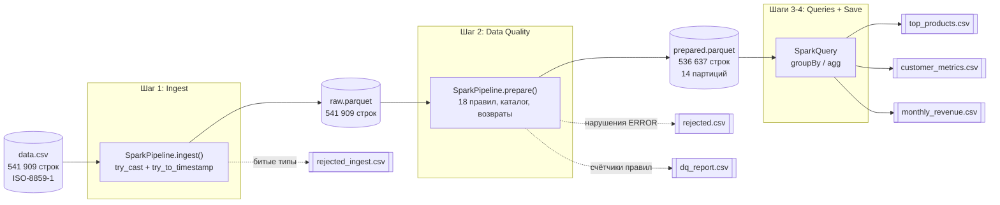
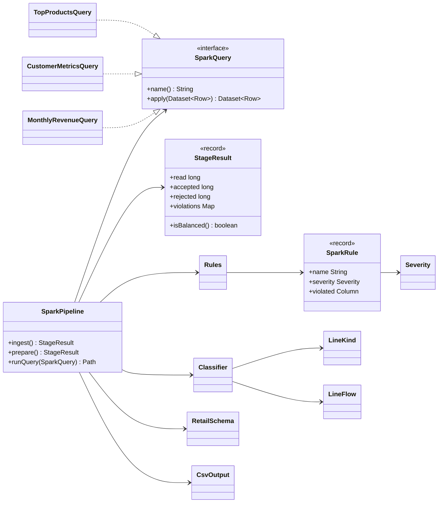
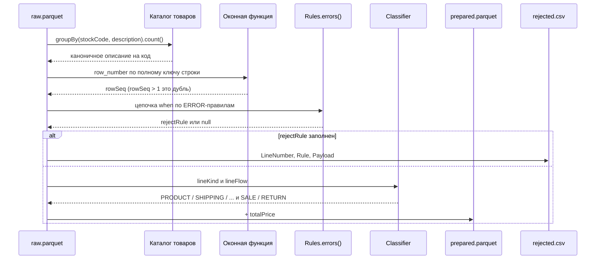
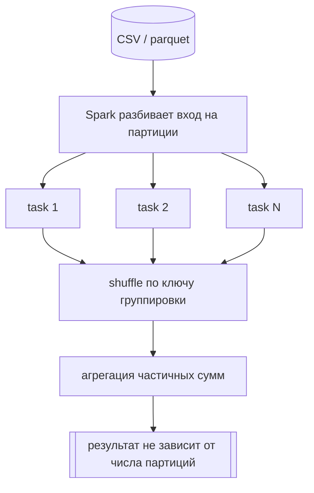

# Архитектура пайплайна на Spark

## Поток данных

Почему два слоя parquet, а не один: правила качества меняются чаще, чем формат
источника. CSV разбирается один раз, дальше DQ-шаг читает колоночный
`raw.parquet` и его можно перезапускать с новыми правилами.

## Классы и интерфейсы

Правило качества это не класс с методом, а запись с выражением `Column`.
Поэтому все 18 правил считаются одним проходом: причина отбраковки собирается
в цепочку `when`, а счётчики нарушений в один `agg`.

## Обработка строки на шаге DQ

Дубли ищутся после нормализации описаний: иначе одна и та же строка с двумя
разными названиями товара дублем не считается.

## Параллелизм

Параллелизм обеспечивает Spark: `local[*]` поднимает по задаче на ядро,
`spark.sql.shuffle.partitions` задаёт параллелизм агрегаций. Деньги считаются
в `decimal(20,4)`, а не в `double`, поэтому суммы точные и не зависят от
порядка слагаемых, то есть от разбиения на партиции.
